# Игра "Утканатор" c графическим интерфейсом
Данный проект является вариантом всем известной игры [Акинатор](https://ru.akinator.com/), реализованной по принципу двоичного справочника на основе полного бинарного дерева с графическим интерфейсом на основе графической библиотеки [raylib](https://www.raylib.com/).

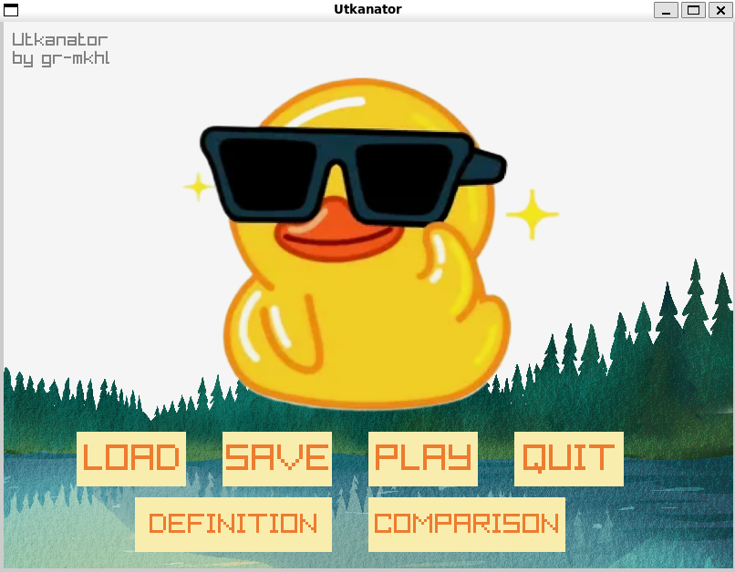


## Как скачать и играть?

>[!WARNING]
>Проект создавался и тестировался на операционной системе Linux, автор не гарантирует корректную работу на других ОС. Для компиляции проекта должен быть установлен компилятор g++, поддерживающий стандарт C++17. Для того, чтобы играть с графическим интерфейсом должна быть установлена графическая библиотека [raylib](https://www.raylib.com/). Для того, чтобы просматривать базу данных Утканатора через графические лог-файлы, необходимо также установить Graphiz и DOT. Во время работы с программой используйте буквы английского алфавита.

Для Ubuntu Linux:

Скачать Утканатора:
```bash
git clone https://github.com/gr-mkhl/AKINATOR.git
```

Скачать Graphiz и DOT:
```bash
sudo apt update
sudo apt install graphviz
```

Инструкцию по установке библиотеки raylib ищите на [официальном сайте](https://www.raylib.com/).

Если вы хотите просматривать базу данных Утканатора, то указывайте при компиляции флаг `-DLOGGING`

Для запуска программы скачайте данный репозиторий и запустите скрипт `AKINATOR/scripts/graphic.sh`

>[!NOTE] Можно протестировать работу Утканатора и без установки графических библиотек, для этого есть упрощенная консольная версия игры(без режимов определения и сравнения), которую можно запустить с помощью скрипта `AKINATOR/scripts/console.sh`.

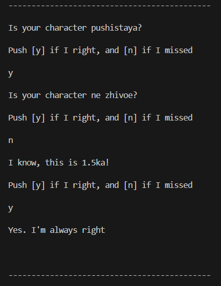

## Режимы игры

На данный момент у Утканатора доступны 3 режима игры:
- угадывание персонажа и добавление новых
- режим определения (definition)
- режим сравнения (comparison)

Можно поиграть в установленные базы знаний Утканатора (они располагаются в папке `AKINATOR/databases`), или же начать свою новую базу знаний.

### Угадывание персонажа и добавление новых
Нажав на кнопку PLAY на главном экране, включится режим угадывания персонажа. Если текущая база знаний пуста, будет предложено добавить в неё первого персонажа (юхуу, это так волнительно). Если в базе уже есть персонажи, то Утканатор будет задавать вопросы, на которые можно отвечать только ДА или НЕТ. В конце игры, либо Утканатор угадывает вашего персонажа и тогда считается, что он победил, либо нет, и тогда вам будет предложено добавить нового персонажа в его базу знаний. Со следующей попытки он уже будет его знать :)

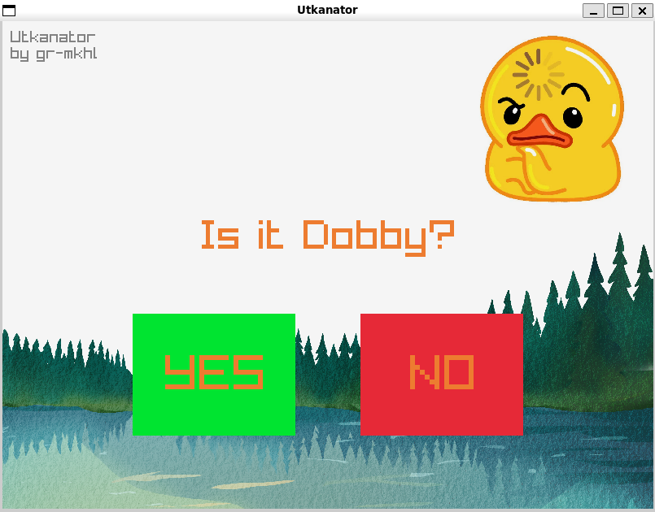
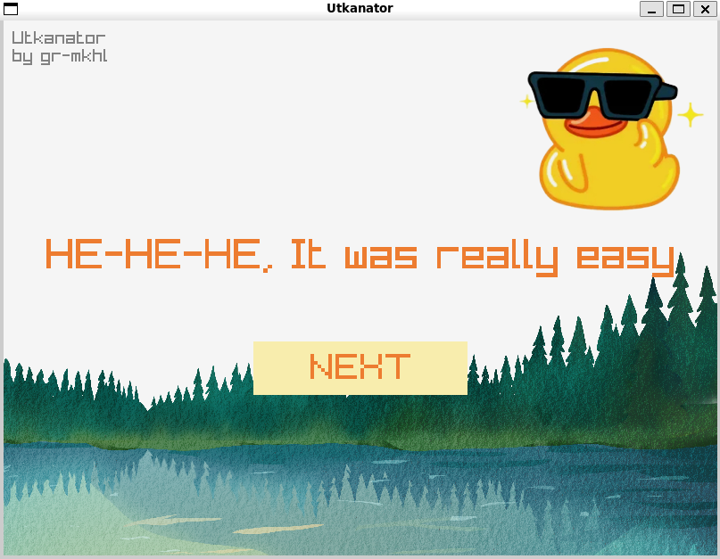
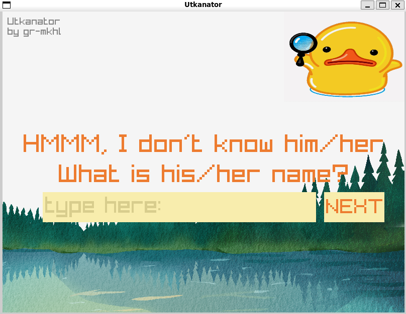
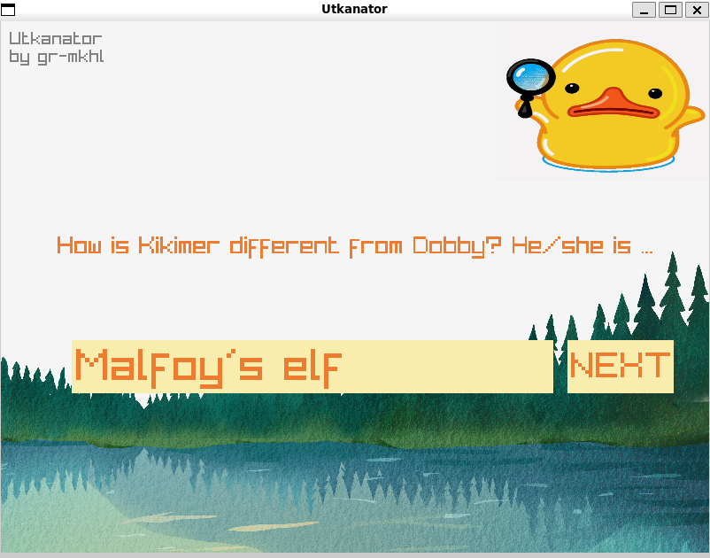


Не забывайте [сохранять](#про-загрузку-и-сохранение-базы-знаний) базу знаний вашего Утканатора перед завершением игры, чтобы не потерять накопленные знания.

### Режим Определения
Нажав на кнопку DEFINITION на главном экране, включится режим выдачи Определений. Введя имя персонажа из текущей базы знаний, вы получите его полное определение (по мнению Утканатора конечно же).

В случае, если такого персонажа в базе нет, он вам конечно же об этом сообщит. Пример определения:

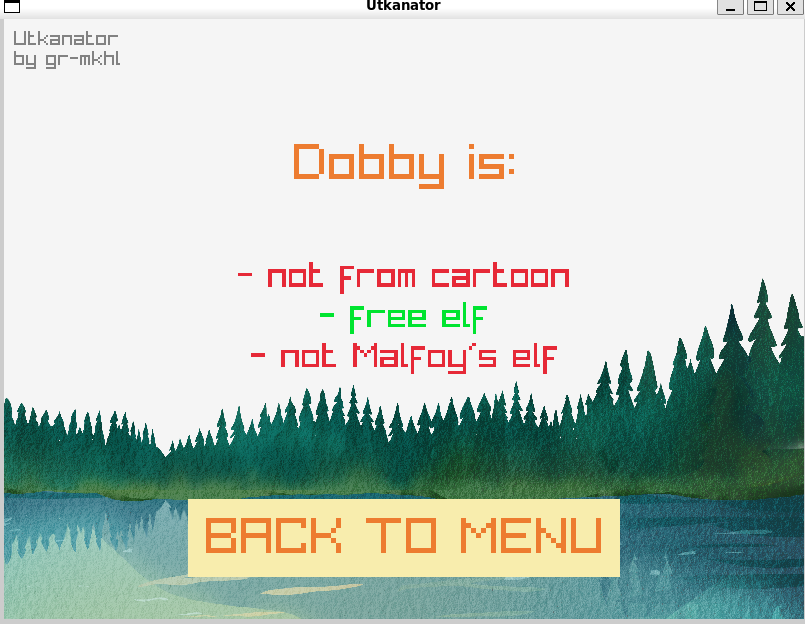

### Режим Сравнения
Нажав на кнопку COMPARISON на главном экране, включится режим Сравнения. Если ввести имена двух персонажей из текущей базы знаний, то Утканатор расскажет вам, чем эти персонажи схожи, а в чем их различия.

Если вы сделаете что-то не так, то Утканатор вряд ли вам это простит и заставит вводить все заново хе-хе-хе. Пример сравнения двух персонажей:

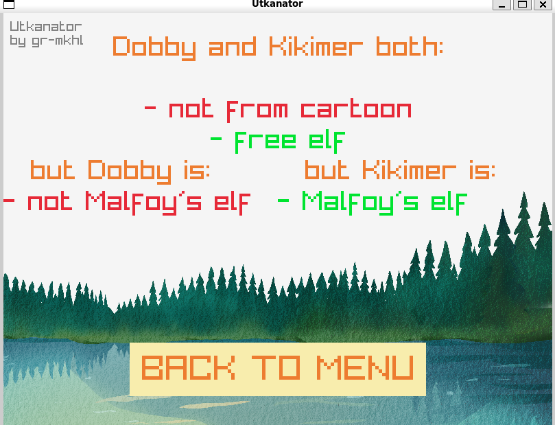

### Про загрузку и сохранение базы знаний
Не хотите каждый раз при заходе в игру начинать новую базу данных? Есть решение! Утканатор умеет сохранять свою базу знаний в .txt формате и загружать ее обратно из своих воспоминаний. Даже не пытайтесь прочитать, что там записано, одному Утканатору дарована такая сила.

По окончанию игры, нажмите на кнопку SAVE и введите имя для нового воспоминания Утканатора.

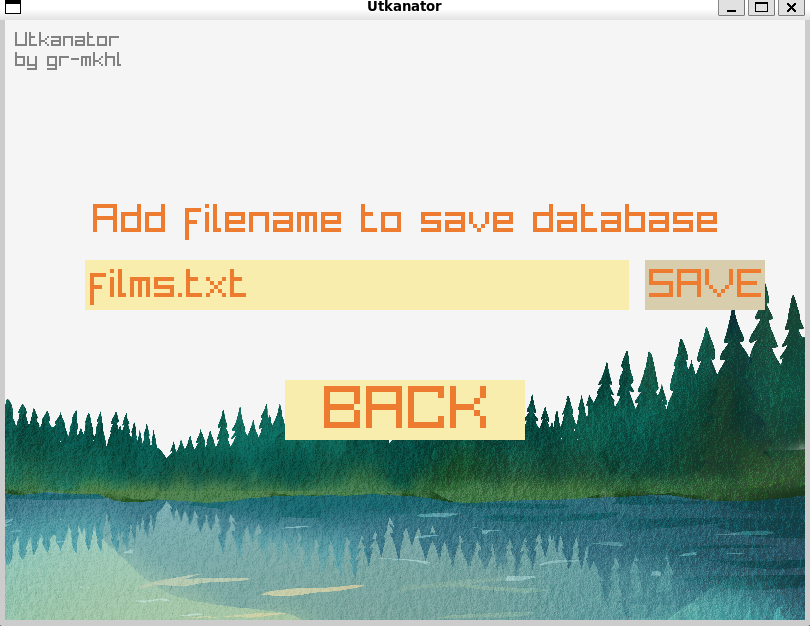

В следующий раз, когда захотите начать с того момента, на котором закончили, достаточно просто нажать на кнопку LOAD и ввести то же имя, Утканатор его найдет.


>[!NOTE]
>Вы можете иметь одновременно много разных сохранений, это позволяет накапливать знания в разных сферах и не смешивать их в одну кучу

## А что "под капотом"?

Утканатор работает по принципу двоичных справочников. База знаний Утканатора представляет из себя полное бинарное дерево, в корне которого располагается самый "общий" вопрос. Продвигаясь к листьям, вопросы становятся все более конкретными, сужая количество вариантов после каждого вопроса вдвое. В самих же листьях располагаются те самые персонажи, которых знает Утканатор. Вот так может выглядеть база знаний Утканатора (графическое представление дерева при помощи Graphviz и DOT):

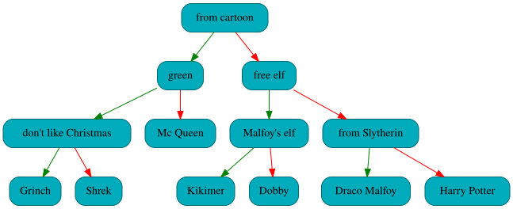

Запись в файл и чтение из файла осуществляется в формате [префиксной записи (preorder/прямая польская запись)](https://ru.wikipedia.org/wiki/Польская_запись?ysclid=mwu29apzx0998901818) при помощи функций `LoadTree()` и `SaveTree()` соответственно. База знаний, записанная в файл выглядит вот так:

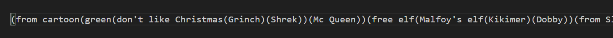

Режимы [Определения](#режим-определения) и [Сравнения](#режим-сравнения) реализованны при помощи полного обхода дерева и сохранения текущего "пути" от корня в стек (последовательность выборов да/нет). В режиме Сравнения сначала выводится совпадающая последовательность из стека, а затем оставшиеся различающиеся последовательности.

С включенным флагом `-DLOGGING` доступен просмотр лог-файлов с записями о ходе игры и графическим выводом дерева:

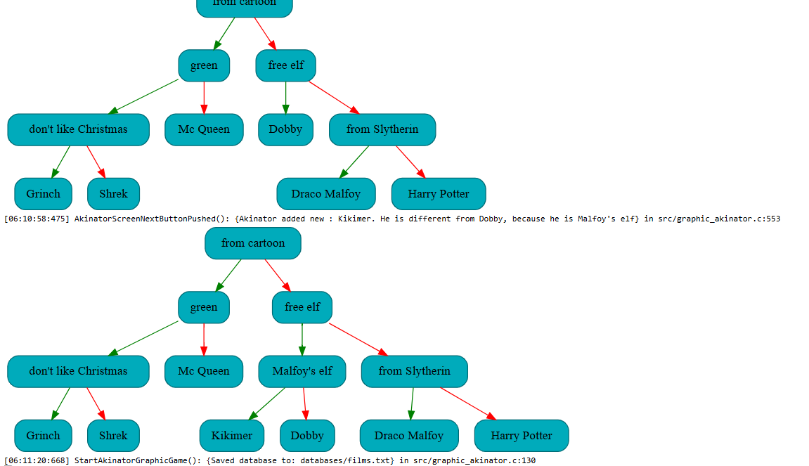

## Фичи

Утканатор активно показывает разные эмоции при разных исходах игры, а нажатия на кнопки сопровождаются соответствующими звуковыми эффектами :)


